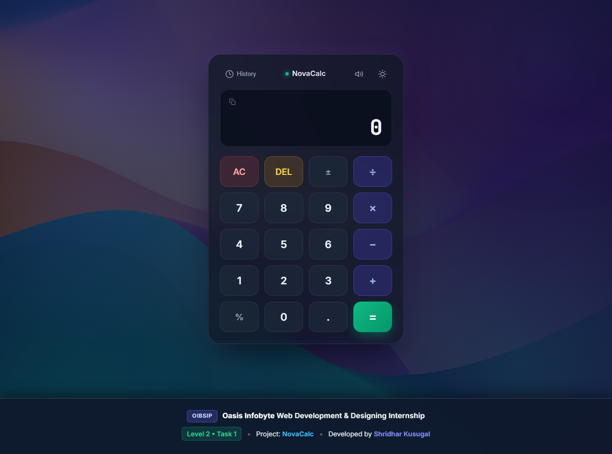
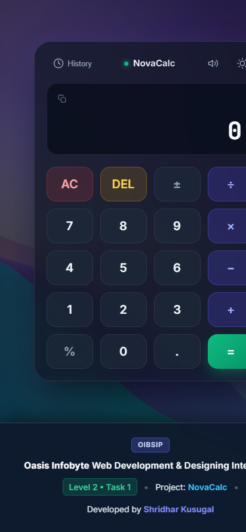

# NovaCalc — Modern Responsive Web Calculator


**NovaCalc** is a modern, responsive, precision calculator web application built strictly with **Semantic HTML5, Pure CSS3, and Vanilla JavaScript**. Designed with a glassmorphism dark aesthetic, tactile animations, full keyboard accessibility, zero-`eval()` calculation security, and a slide-over calculation history log.

Developed as part of the **Oasis Infobyte (OIBSIP) Web Development and Designing Internship** — **Level 2, Task 1**.

---

## 👨‍💻 Intern Details

- **Intern Name:** Shridhar Kusugal
- **Internship Program:** Web Development and Designing Internship
- **Organization:** [Oasis Infobyte](https://oasisinfobyte.com/)
- **Repository:** [ShridharKusugal/OIBSIP](https://github.com/ShridharKusugal/OIBSIP)
- **Task:** Level 2 — Task 1: Responsive Calculator (NovaCalc)

---

## 📸 Application Screenshots

### Desktop & Mobile Previews

| Desktop Viewport (1280 × 950) | Mobile Viewport (412 × 890) |
| :---: | :---: |
|  |  |

---

## ✨ Features & Functionalities

1. **Full Arithmetic Engine (Strictly No `eval()`):**
   - Direct mathematical computation using a secure state machine and explicit switch-case logic.
   - Eliminates all security vulnerabilities associated with `eval()`.

2. **Precision Floating-Point Calculation:**
   - Mitigates standard IEEE 754 floating-point rounding quirks (e.g., `0.1 + 0.2 = 0.3` instead of `0.30000000000000004`).

3. **Core Arithmetic Operations:**
   - **Addition (`+`)**, **Subtraction (`-`)**, **Multiplication (`×`)**, **Division (`÷`)**.
   - **Percentage (`%`)**: Standalone division by 100 or contextual compound percentage calculation.
   - **Sign Negation (`±`)**: Effortlessly toggle between positive and negative numbers.
   - **Decimal Input (`.`)**: Smart decimal handler preventing multiple decimal points in a single operand.

4. **Safety & Error Handling:**
   - Graceful **Division by Zero** detection: Displays a clear `"Cannot divide by zero"` notice with shake animation instead of crashing with `Infinity`.
   - Any subsequent numeric input resets the error state automatically.

5. **Comprehensive Keyboard Integration:**
   - **0 – 9**: Number input
   - **`+`, `-`, `*`, `/`**: Basic arithmetic operators
   - **`Enter` or `=`**: Compute final result
   - **`Backspace`**: Delete last character (`DEL`)
   - **`Escape` or `C`**: Clear all (`AC`)
   - **`%`**: Percentage
   - **`F9`**: Sign toggle (`±`)
   - Visual button animation on physical key presses for tactile feedback.

6. **Calculation History Drawer:**
   - Persists previous operations and results in a slide-over panel.
   - Click any historical record to restore its value directly into the active calculation.
   - Includes a one-click history clearing utility.

7. **Theme Switcher (Dark & Light Modes):**
   - Toggle seamlessly between modern Dark Slate glassmorphism and crisp Light Mode.
   - Automatically remembers theme preference across sessions using `localStorage`.

8. **Clipboard Copy Utility:**
   - Click the display copy button to instantly copy the calculated result to your system clipboard.

9. **Synthesized Click Audio (Web Audio API):**
   - Optional tactile click sound synthesized dynamically via the Web Audio API without requiring external MP3/WAV assets.

10. **Fully Responsive Design:**
    - Custom fluid layout built with CSS Grid and Flexbox.
    - Optimized for extra-small mobile devices (320px), tablets (768px), and ultra-wide desktop monitors (1440px+).

---

## 🗂️ Project Structure

```
OIBSIP/
└── Level-2-Task-1-Calculator/
    ├── index.html              # Semantic HTML5 layout and accessibility markup
    ├── style.css               # Pure CSS3 styling, glassmorphism, responsive grid & themes
    ├── script.js               # Pure Vanilla JS arithmetic engine, keyboard binding & history
    ├── background.jpg          # High-resolution aesthetic ambient wallpaper
    ├── README.md               # Comprehensive project documentation & test cases
    └── screenshots/            # High-resolution screenshots of the interface
        ├── calculator-desktop.png
        └── calculator-mobile.png
```

---

## 🚀 How to Run Locally

### Option 1: Direct File Execution (Simplest)
1. Navigate to the project directory:
   ```bash
   cd OIBSIP/Level-2-Task-1-Calculator
   ```
2. Double-click `index.html` or right-click and select **Open with Google Chrome** (or any modern web browser).

### Option 2: Using Python Built-in HTTP Server
```bash
# Navigate to the folder
cd OIBSIP/Level-2-Task-1-Calculator

# Launch local server
python -m http.server 3000
```
Open [http://localhost:3000](http://localhost:3000) in your web browser.

### Option 3: Using VS Code Live Server Extension
1. Open the folder in **Visual Studio Code**.
2. Right-click on `index.html`.
3. Select **"Open with Live Server"**.

---

## 🧪 Comprehensive Manual Testing Checklist

| Test Case # | Description | Steps / Input | Expected Result | Status |
| :---: | :--- | :--- | :--- | :---: |
| **TC-01** | Basic Addition | Press `2` `5` `+` `1` `5` `=` | Display shows `40` | ✅ Passed |
| **TC-02** | Decimal Precision | Press `0` `.` `1` `+` `0` `.` `2` `=` | Display shows `0.3` (not `0.30000000000000004`) | ✅ Passed |
| **TC-03** | Subtraction | Press `1` `0` `0` `-` `4` `5` `.` `5` `=` | Display shows `54.5` | ✅ Passed |
| **TC-04** | Multiplication | Press `1` `2` `.` `5` `×` `4` `=` | Display shows `50` | ✅ Passed |
| **TC-05** | Standard Division | Press `1` `0` `0` `÷` `8` `=` | Display shows `12.5` | ✅ Passed |
| **TC-06** | Division by Zero Handling | Press `5` `0` `÷` `0` `=` | Display shows `"Cannot divide by zero"` in red with shake animation | ✅ Passed |
| **TC-07** | Auto-Reset after Error | From error state, press `7` | Display clears error and shows `7` | ✅ Passed |
| **TC-08** | Percentage (Standalone) | Press `2` `5` `%` | Display shows `0.25` | ✅ Passed |
| **TC-09** | Percentage (Chained) | Press `2` `0` `0` `+` `1` `0` `%` `=` | Display computes 10% of 200 (20) and yields `220` | ✅ Passed |
| **TC-10** | Sign Toggle (`±`) | Press `5`, then `±` | Display toggles to `-5`; press again toggles to `5` | ✅ Passed |
| **TC-11** | Negative Arithmetic | Press `5` `±` `+` `1` `0` `=` | Display shows `5` (`-5 + 10`) | ✅ Passed |
| **TC-12** | Single Decimal Constraint | Press `5` `.` `.` `2` `.` `1` | Only the first `.` is accepted (`5.21`) | ✅ Passed |
| **TC-13** | Backspace (`DEL`) | Press `1` `2` `3` `4`, then `DEL` | Display shows `123` | ✅ Passed |
| **TC-14** | Clear All (`AC`) | Press `9` `8` `7` `+` `1` `2`, then `AC` | Display resets to `0`, operator and history expression cleared | ✅ Passed |
| **TC-15** | Consecutive Operator Switch | Press `1` `0` `+`, then click `×` | Operator updates to `×` without recalculating | ✅ Passed |
| **TC-16** | Chaining Operations | Press `5` `+` `5` `+` `5` `=` | First `+` produces intermediate `10`, then `15` | ✅ Passed |
| **TC-17** | Keyboard Input (Full Set) | Type digits, `+`, `-`, `*`, `/`, `Enter`, `Backspace`, `Esc` | All keys register properly with visible button depression | ✅ Passed |
| **TC-18** | History Recall | Open history drawer, click an older result | Result is restored to current active operand | ✅ Passed |
| **TC-19** | Theme Toggle | Click Sun/Moon icon | Switches between Dark and Light mode, saved to `localStorage` | ✅ Passed |
| **TC-20** | Responsive Viewports | Test on Mobile (375px), Tablet (768px), Desktop (1440px) | Layout, button sizes, and typography adapt smoothly without horizontal overflow | ✅ Passed |

---

## 🛠️ Technologies Used

- **HTML5:** Semantic document markup, ARIA accessibility attributes, meta tags.
- **CSS3:** Custom properties (CSS variables), CSS Grid, Flexbox, backdrop-filter glassmorphism, keyframe animations, mobile-first media queries.
- **Vanilla JavaScript (ES6+):** Modular IIFE pattern, state management, event listeners, keyboard event trapping, Web Audio API, Clipboard API, `localStorage`.
- **Google Fonts:** `Inter` (UI typography) and `JetBrains Mono` (digit display typography).

---

## ⚖️ License & Attribution

This project is submitted for evaluation under **Level 2, Task 1** of the **Oasis Infobyte Web Development and Designing Internship Program**.

Created with passion by **Shridhar Kusugal**.

