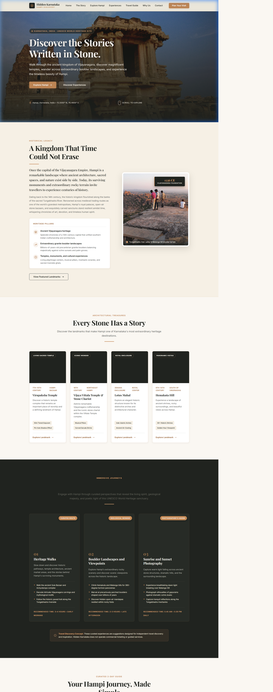
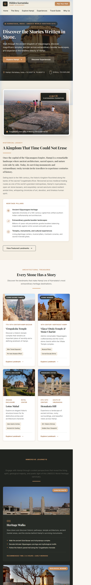

# OIBSIP — Oasis Infobyte Internship Projects

Welcome to the **Oasis Infobyte (OIBSIP) Web Development and Designing Internship** repository. This repository showcases the completed and ongoing projects assigned during the internship program.

---

## 👨‍💻 Intern Details

- **Intern Name:** Shridhar Kusugal
- **Domain:** Web Development and Designing
- **Organization:** [Oasis Infobyte](https://oasisinfobyte.com/)
- **Repository:** [ShridharKusugal/OIBSIP](https://github.com/ShridharKusugal/OIBSIP)

---

## 📂 Internship Tasks Overview

| Task # | Task Name | Technologies | Status | Project Directory |
| :---: | :--- | :--- | :---: | :--- |
| **01** | **Landing Page: Hidden Karnataka (Hampi)** | HTML5, Pure CSS3 | ✅ Completed | [Explore Task 1](./WebDev-L1-LandingPage-HiddenKarnataka/) |
| **02** | **Personal Portfolio Website** | HTML5, CSS3, JavaScript | 🚀 In Progress | `WebDev-L1-PersonalPortfolio/` |
| **03** | **Temperature Converter Website** | HTML5, CSS3, JavaScript | 🚀 In Progress | `WebDev-L1-TemperatureConverter/` |

---

## 🏛️ Task 1: Landing Page — Hidden Karnataka (Hampi)

> **"Discover the Stories Written in Stone."**  
> A premium, responsive travel-editorial landing page celebrating the ancient UNESCO World Heritage destination of **Hampi, Karnataka, India**.

### 🌟 Highlights & Features
- **Strictly No JavaScript & No CSS Frameworks:** Built with pure, semantic HTML5 and vanilla CSS3.
- **Glassmorphic Navigation Bar:** Translucent sticky navbar with backdrop blur and responsive layout.
- **Cinematic Hero Section:** Full-viewport banner featuring the iconic Stone Chariot at Vijaya Vittala Temple.
- **Story of Hampi:** 2-column narrative detailing the 14th-century Vijayanagara Empire.
- **Interactive Landmark Cards:** Pure CSS grid showcasing Virupaksha Temple, Vijaya Vittala Temple, Lotus Mahal, and Hemakuta Hill with elegant hover lift effects.
- **Immersive Experiences:** Contrasting charcoal-themed visual cards for heritage walks, boulder trails, and sunset viewpoints.
- **Curated 2-Day Itinerary:** Structured travel guide timeline with practical advisories.
- **Fully Responsive:** Custom-crafted layouts optimized for Mobile (375px), Tablet (768px), and Desktop (1280px+).

### 📸 Preview
| Desktop Viewport | Mobile Viewport |
| :---: | :---: |
|  |  |

For detailed documentation, design decisions, and setup instructions, see the [Task 1 README](./WebDev-L1-LandingPage-HiddenKarnataka/README.md).

---

## 🏃 How to Run the Projects Locally

1. **Clone the repository:**
   ```bash
   git clone https://github.com/ShridharKusugal/OIBSIP.git
   cd OIBSIP
   ```

2. **Run Task 1 (Landing Page):**
   - Direct Open: Navigate to `WebDev-L1-LandingPage-HiddenKarnataka/` and double-click `index.html`.
   - Using Python HTTP Server:
     ```bash
     cd WebDev-L1-LandingPage-HiddenKarnataka
     python -m http.server 8000
     ```
     Then open `http://localhost:8000` in your browser.
   - Using VS Code: Right-click `index.html` and select **"Open with Live Server"**.

---

## ⚖️ License & Attribution

All projects within this repository are created for educational and internship demonstration purposes under the Oasis Infobyte Internship Program. Photographs are authentic monuments of Hampi sourced from Wikimedia Commons under Creative Commons licenses.
