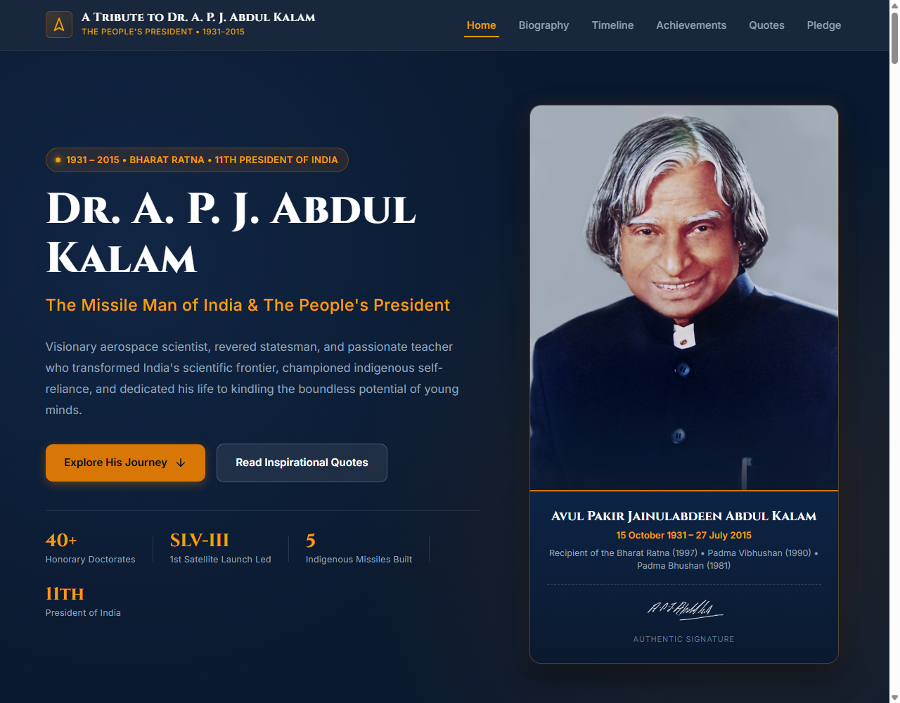
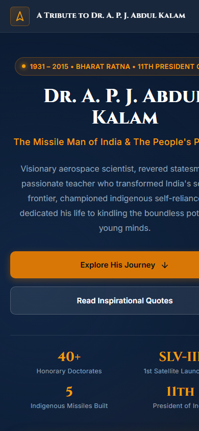

# OIBSIP — Oasis Infobyte Internship Projects

Welcome to the **Oasis Infobyte (OIBSIP) Web Development and Designing Internship** repository. This repository showcases the completed and ongoing projects assigned during the internship program.

---

## 👨‍💻 Intern Details

- **Intern Name:** Shridhar Kusugal
- **Domain:** Web Development and Designing
- **Organization:** [Oasis Infobyte](https://oasisinfobyte.com/)
- **Repository:** [ShridharKusugal/OIBSIP](https://github.com/ShridharKusugal/OIBSIP)

---

## 📂 Internship Tasks Overview

### Level 1 Tasks

| Task # | Task Name | Technologies | Status | Project Directory |
| :---: | :--- | :--- | :---: | :--- |
| **01** | **Landing Page: Hidden Karnataka (Hampi)** | HTML5, Pure CSS3 | ✅ Completed | [Explore Task 1](./WebDev-L1-LandingPage-HiddenKarnataka/) |
| **02** | **Personal Portfolio Website** | HTML5, CSS3, JavaScript | ✅ Completed | [Explore Task 2](./WebDev-L1-PersonalPortfolio/) |
| **03** | **Temperature Converter Website** | HTML5, CSS3, JavaScript | 🚀 In Progress | `WebDev-L1-TemperatureConverter/` |

### Level 2 Tasks

| Task # | Task Name | Technologies | Status | Project Directory |
| :---: | :--- | :--- | :---: | :--- |
| **01** | **NovaCalc: Responsive Calculator Web Application** | HTML5, CSS3, Vanilla JavaScript | ✅ Completed | [Explore Level 2 Task 1](./Level-2-Task-1-Calculator/) |
| **02** | **A Tribute to Dr. A. P. J. Abdul Kalam** | HTML5, CSS3, Vanilla JavaScript | ✅ Completed | [Explore Level 2 Task 2](./WebDevelopment-Level2-TributePage/) |

---

## 🚀 Level 2 • Task 2: A Tribute to Dr. A. P. J. Abdul Kalam — The Missile Man of India

> **"Dream is not that which you see while sleeping; it is something that does not let you sleep."**  
> An editorial, responsive tribute website honoring the life, scientific triumphs, presidency, and eternal wisdom of **Dr. A. P. J. Abdul Kalam** (1931–2015).

### 🌟 Highlights & Features
- **Semantic HTML5 & Editorial UI/UX:** Crafted with dignified typography (Cinzel & Inter), deep midnight navy (`#0a192f`), and restrained saffron accents (`#d97706`).
- **Reading Progress & Sticky Navigation:** Top scroll progress indicator with sticky translucent navbar and automatic ScrollSpy link highlighting.
- **Biographical Narrative:** Four comprehensive editorial chapters detailing his early roots in Rameswaram, aeronautics passion at MIT Madras, space and defense leadership, and people's presidency.
- **Vertical Milestones Timeline:** Interactive chronological journey with key turning points (1931 birth, 1960 DRDO, 1969 ISRO, 1980 Rohini SLV-III launch, 1997 Bharat Ratna, 2002 Presidency, and 2015 final lecture at IIM Shillong).
- **Achievements Filter Grid:** Dynamic client-side categorization for space breakthroughs, guided missiles (IGMDP), national honors, and biomedical innovations (Kalam-Raju Stent).
- **Inspirational Quotes Carousel & One-Click Copy:** Verified quotations with category pills, smooth indicator transitions, and instant clipboard copy.
- **Dr. Kalam's 10-Point Youth Oath:** Interactive pledge checklist with visual completion meter and congratulatory state.
- **Authentic Photography & Zero External Libraries:** Uses genuine, optimized public domain portraits from Wikimedia Commons; zero framework dependencies, zero `eval()`.
- **Fully Responsive & Accessible:** Tailored breakpoints across mobile, tablet, and desktop viewports, with WCAG AA compliance and `prefers-reduced-motion` support.

### 📸 Preview
| Desktop Viewport | Mobile Viewport |
| :---: | :---: |
|  |  |

For detailed documentation, test cases, and setup instructions, see the [Level 2 Task 2 README](./WebDevelopment-Level2-TributePage/README.md).

---

## 🧮 Level 2 • Task 1: NovaCalc — Modern Responsive Web Calculator

> **"Precision arithmetic engineered with elegant glassmorphism and tactile responsiveness."**  
> A feature-rich, standalone calculator application built strictly with **Semantic HTML5, CSS3, and Vanilla JavaScript** without external libraries or `eval()`.

### 🌟 Highlights & Features
- **Zero-`eval()` Security:** Direct computation engine using an encapsulated state machine and explicit switch-case logic.
- **Precision Floating-Point Calculation:** Eliminates IEEE 754 floating-point inaccuracies (e.g., `0.1 + 0.2 = 0.3`).
- **Complete Operation Suite:** Addition, subtraction, multiplication, division, percentage, sign negation (`±`), and decimals.
- **Graceful Error Handling:** Intercepts division by zero and displays a gentle error notice (`"Cannot divide by zero"`) with shake animation.
- **Full Physical Keyboard Support:** Digits `0-9`, operators `+`, `-`, `*`, `/`, `Enter`/`=`, `Backspace` (DEL), `Escape` (AC), `%`, and `F9` (`±`).
- **Calculation History Drawer:** Slide-over panel storing previous calculations with interactive click-to-restore functionality.
- **Theme Switcher & Web Audio Feedback:** Toggle between Dark Glass and Clean Light themes; optional synthesized mechanical click sound via Web Audio API.
- **Clipboard One-Click Copy:** Fast copy-to-clipboard button with visual tooltip confirmation.
- **Fully Responsive:** Beautifully crafted layouts for Mobile (320px–480px), Tablet (768px), and Desktop (1280px+).

### 📸 Preview
| Desktop Viewport | Mobile Viewport |
| :---: | :---: |
|  |  |

For detailed documentation, test cases, and setup instructions, see the [Level 2 Task 1 README](./Level-2-Task-1-Calculator/README.md).

---

## 🏛️ Task 1: Landing Page — Hidden Karnataka (Hampi)

> **"Discover the Stories Written in Stone."**  
> A premium, responsive travel-editorial landing page celebrating the ancient UNESCO World Heritage destination of **Hampi, Karnataka, India**.

### 🌟 Highlights & Features
- **Strictly No JavaScript & No CSS Frameworks:** Built with pure, semantic HTML5 and vanilla CSS3.
- **Glassmorphic Navigation Bar:** Translucent sticky navbar with backdrop blur and responsive layout.
- **Cinematic Hero Section:** Full-viewport banner featuring the iconic Stone Chariot at Vijaya Vittala Temple.
- **Story of Hampi:** 2-column narrative detailing the 14th-century Vijayanagara Empire.
- **Interactive Landmark Cards:** Pure CSS grid showcasing Virupaksha Temple, Vijaya Vittala Temple, Lotus Mahal, and Hemakuta Hill with elegant hover lift effects.
- **Immersive Experiences:** Contrasting charcoal-themed visual cards for heritage walks, boulder trails, and sunset viewpoints.
- **Curated 2-Day Itinerary:** Structured travel guide timeline with practical advisories.
- **Fully Responsive:** Custom-crafted layouts optimized for Mobile (375px), Tablet (768px), and Desktop (1280px+).

### 📸 Preview
| Desktop Viewport | Mobile Viewport |
| :---: | :---: |
|  |  |

For detailed documentation, design decisions, and setup instructions, see the [Task 1 README](./WebDev-L1-LandingPage-HiddenKarnataka/README.md).

---

## 💼 Level 1 • Task 2: Personal Portfolio Website — Shridhar Kusugal

> **"Building Ideas Into Digital Experiences."**  
> A modern, accessible, and responsive personal portfolio showcasing technical competencies in Python, MySQL, database systems, and full-stack web engineering.

### 🌟 Highlights & Features
- **Hero Profile Showcase:** Full-height, high-resolution portrait card with glowing accent border, live status pill (*"Active & Ready to Collaborate"*), and interactive 3D perspective tilt reacting to cursor motion on desktop.
- **Glassmorphic Navigation Bar:** Sticky translucent navbar with backdrop blur, theme toggle, and responsive mobile drawer navigation.
- **Client-Side Theme Engine:** Smooth Dark Mode and Clean Light Mode switching with local storage persistence.
- **Technical Skills Matrix:** Structured categorization across Programming Languages (Python, SQL, JavaScript), Relational Databases (MySQL), Frontend, and Workflow Tools (Git, VS Code).
- **Projects & Academic Milestones:** Detailed software showcase and chronological education timeline (MCA @ Chetan Business School).
- **Direct Collaboration Channels:** Interactive LinkedIn, GitHub, and contact links.
- **Zero Framework Overhead:** Built strictly with semantic HTML5, modern CSS3, and vanilla JavaScript.

For detailed documentation, design decisions, and setup instructions, see the [Level 1 Task 2 README](./WebDev-L1-PersonalPortfolio/README.md).

---

## 💻 How to Run the Projects Locally

1. **Clone the repository:**
   ```bash
   git clone https://github.com/ShridharKusugal/OIBSIP.git
   cd OIBSIP
   ```

2. **Run Level 1 Task 2 (Personal Portfolio):**
   - Direct Open: Navigate to `WebDev-L1-PersonalPortfolio/` and double-click `index.html`.
   - Using Python HTTP Server:
     ```bash
     cd WebDev-L1-PersonalPortfolio
     python -m http.server 8000
     ```
     Then open `http://localhost:8000` in your browser.
   - Using VS Code: Right-click `index.html` and select **"Open with Live Server"**.

3. **Run Level 2 Task 2 (Tribute Page):**
   - Direct Open: Navigate to `WebDevelopment-Level2-TributePage/` and double-click `index.html`.
   - Using Python HTTP Server:
     ```bash
     cd WebDevelopment-Level2-TributePage
     python -m http.server 5000
     ```
     Then open `http://localhost:5000` in your browser.
   - Using VS Code: Right-click `index.html` and select **"Open with Live Server"**.

4. **Run Level 2 Task 1 (Responsive Calculator):**
   - Direct Open: Navigate to `Level-2-Task-1-Calculator/` and double-click `index.html`.
   - Using Python HTTP Server:
     ```bash
     cd Level-2-Task-1-Calculator
     python -m http.server 3000
     ```
     Then open `http://localhost:3000` in your browser.
   - Using VS Code: Right-click `index.html` and select **"Open with Live Server"**.

5. **Run Level 1 Task 1 (Landing Page):**
   - Direct Open: Navigate to `WebDev-L1-LandingPage-HiddenKarnataka/` and double-click `index.html`.
   - Using Python HTTP Server:
     ```bash
     cd WebDev-L1-LandingPage-HiddenKarnataka
     python -m http.server 8080
     ```
     Then open `http://localhost:8080` in your browser.
   - Using VS Code: Right-click `index.html` and select **"Open with Live Server"**.

---

## ⚖️ License & Attribution

All projects within this repository are created for educational and internship demonstration purposes under the Oasis Infobyte Internship Program. Photographs and historical records are sourced from Wikimedia Commons and official archives under fair academic and Creative Commons licenses.
