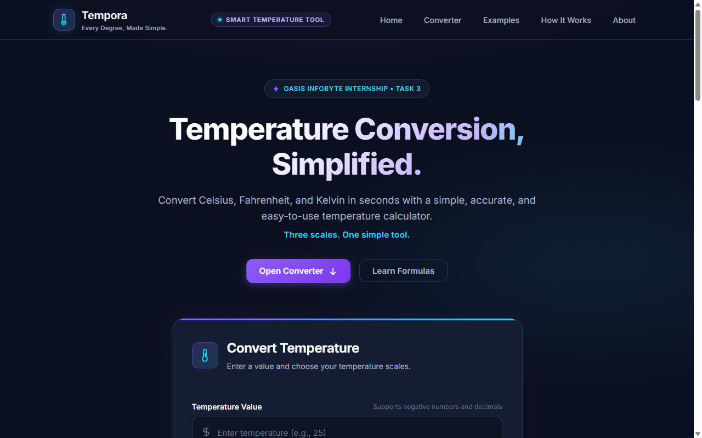
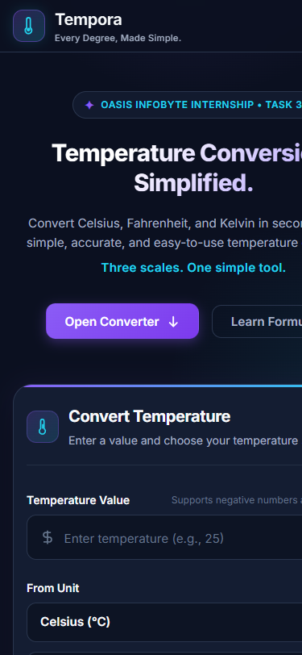

# Tempora — Modern Temperature Converter Web Application


**Tempora** is a modern, responsive, and scientifically accurate temperature conversion utility built strictly using **Semantic HTML5, CSS3, and Vanilla JavaScript**. It enables effortless bidirectional conversions between **Celsius (°C)**, **Fahrenheit (°F)**, and **Kelvin (K)**, featuring real-time calculation, an interactive thermal spectrum gauge, physical validation above absolute zero, and an intelligent **"What This Result Means"** dynamic real-world context analyzer.

Developed as part of the **Oasis Infobyte (OIBSIP) Web Development and Designing Internship** — **Level 1, Task 3**.

---

## 👨‍💻 Intern Details

- **Intern Name:** Shridhar Kusugal
- **Domain:** Web Development and Designing
- **Organization:** [Oasis Infobyte](https://oasisinfobyte.com/)
- **Repository:** [ShridharKusugal/OIBSIP](https://github.com/ShridharKusugal/OIBSIP)
- **Task:** Level 1 — Task 3: Temperature Converter Website (Tempora)

---

## 📸 Application Screenshots

### Desktop & Mobile Previews

| Desktop Viewport (1280 × 800) | Mobile Viewport (412 × 890) |
| :---: | :---: |
|  |  |

---

## ✨ Features & Capabilities

1. **Three Primary Temperature Scales:**
   - **Celsius (°C):** The metric and everyday international standard scale.
   - **Fahrenheit (°F):** The customary scale utilized primarily in the United States.
   - **Kelvin (K):** The base unit of temperature in the International System of Units (SI).

2. **Accurate Two-Step Mathematical Pipeline:**
   - Universal intermediate conversion to Celsius to ensure high mathematical fidelity.
   - Smart floating-point rounding (eliminates precision glitches such as `31.9999999999` $\rightarrow$ `32`).

3. **Live Real-Time Conversion & Instant Feedback:**
   - Computes and updates results immediately as the user enters numeric values.
   - Dynamic unit switching when updating scale dropdowns or clicking the **Swap** button.

4. **"What This Result Means" — Real-World Context Analyzer:**
   - Automatically adapts across 19 physical temperature zones ranging from **Absolute Zero ($-273.15\text{ }^\circ\text{C}$)** to **Astrophysical Heat ($1500+\text{ }^\circ\text{C}$)**.
   - **Dynamic Category Badge:** (e.g., *Room Comfort Zone*, *Water Freezing Landmark*, *Human Body Baseline*, *Water Boiling Landmark*, *Deep Cryogenic Realm*, *Baking & Cooking Heat*).
   - **Detailed Physical Narrative:** Explains the physical, biological, and practical meaning of the temperature.
   - **3 Quick-Insight Metadata Chips:**
     - **Experience / Feel:** (e.g., *Optimal Living Comfort*, *Instant Flash Freeze*, *Vigorous Scalding Steam*).
     - **Water Phase State:** (e.g., *Liquid*, *Phase Transition: Water ⇌ Ice*, *Superheated Dry Steam*, *Rigid Crystalline Ice*).
     - **Nearest Benchmark:** (e.g., *Standard Room Temp (~21 °C)*, *Normothermia (37 °C)*, *Food Refrigerator (~4 °C)*).
   - **Practical & Safety Advice:** Actionable guidance covering attire, frostbite timeframes, heatstroke risks, or culinary tips.

5. **Visual Thermal Spectrum Indicator:**
   - Continuous color gradient spectrum track spanning from cryogenic blue to boiling coral-red.
   - Animated indicator thumb visually tracking qualitative placement (*Absolute Zero $\rightarrow$ Freezing $\rightarrow$ Room $\rightarrow$ Body $\rightarrow$ Boiling*).

6. **Absolute Zero Physical Boundary Validation:**
   - Validates inputs against theoretical physical minimums before computation:
     - **Kelvin:** $\ge 0\text{ K}$
     - **Celsius:** $\ge -273.15\text{ }^\circ\text{C}$
     - **Fahrenheit:** $\ge -459.67\text{ }^\circ\text{F}$
   - Displays gentle, accessible error notices with auto-clearing upon correction.

7. **Quick Reference Benchmarks with One-Click Testing:**
   - Includes standard scientific reference cards:
     - Water Freezing Point ($0\text{ }^\circ\text{C} = 32\text{ }^\circ\text{F} = 273.15\text{ K}$)
     - Water Boiling Point ($100\text{ }^\circ\text{C} = 212\text{ }^\circ\text{F} = 373.15\text{ K}$)
     - Kelvin Ice Point ($273.15\text{ K} = 0\text{ }^\circ\text{C} = 32\text{ }^\circ\text{F}$)
   - Clicking **"Try in Converter"** automatically pre-fills the converter and displays the conversion.

8. **One-Click Clipboard Copy:**
   - Instantly copies formatted equations (e.g., `25 °C = 77 °F`) with visual confirmation.

9. **Rich Informational Footer:**
   - 4-column balanced layout with product description, quick navigation links, scale symbols, and key thermal physical landmarks.

10. **Zero External Dependencies:**
    - Pure semantic HTML5, modern CSS3 variables and layout grids, and vanilla JavaScript (no npm, no React, no third-party libraries).

---

## 📐 Conversion Formulas Implemented

| Conversion Path | Exact Formula |
| :--- | :--- |
| **Celsius to Fahrenheit** | $^\circ\text{F} = (^\circ\text{C} \times \frac{9}{5}) + 32$ |
| **Fahrenheit to Celsius** | $^\circ\text{C} = (^\circ\text{F} - 32) \times \frac{5}{9}$ |
| **Celsius to Kelvin** | $\text{K} = ^\circ\text{C} + 273.15$ |
| **Kelvin to Celsius** | $^\circ\text{C} = \text{K} - 273.15$ |
| **Fahrenheit to Kelvin** | $\text{K} = (^\circ\text{F} - 32) \times \frac{5}{9} + 273.15$ |
| **Kelvin to Fahrenheit** | $^\circ\text{F} = (\text{K} - 273.15) \times \frac{9}{5} + 32$ |

---

## 📁 Directory Structure

```
WebDev-L1-TemperatureConverter/
├── index.html            # Semantic HTML5 markup and layout
├── style.css             # Responsive CSS3 styling, design tokens & typography
├── script.js             # Vanilla JS conversion logic, thermal gauge & meaning analyzer
├── screenshots/          # Application preview imagery
│   ├── converter-desktop.png
│   └── converter-mobile.png
└── README.md             # Comprehensive task documentation
```

---

## 🏃 How to Run Locally

Since the application is built entirely with standard web technologies, no build tools or package managers are required:

### Option 1: Direct Browser Launch
Navigate into the folder and double-click `index.html` (or right-click $\rightarrow$ **Open with Browser**).

### Option 2: Python HTTP Server (Recommended)
```bash
cd WebDev-L1-TemperatureConverter
python -m http.server 8000
```
Then visit **[http://localhost:8000](http://localhost:8000)** in your browser.

### Option 3: VS Code Live Server
Open the project directory in Visual Studio Code, right-click `index.html`, and click **"Open with Live Server"**.

---

## ♿ Accessibility & Standards

- **Semantic Landmark Elements:** Proper usage of `<header>`, `<main>`, `<section>`, `<footer>`, `<form>`, `<label>`, and `<nav>`.
- **Keyboard Navigation:** Full support for `Tab`, `Shift+Tab`, and `Enter` key execution.
- **ARIA & Live Regions:** Results and validation errors are announced to screen readers via `aria-live="polite"` and `role="alert"`.
- **Reduced Motion Support:** Respects system preferences via `@media (prefers-reduced-motion: reduce)`.

---

## ⚖️ License

Developed by **Shridhar Kusugal** for the **Oasis Infobyte (OIBSIP) Web Development and Designing Internship**.
